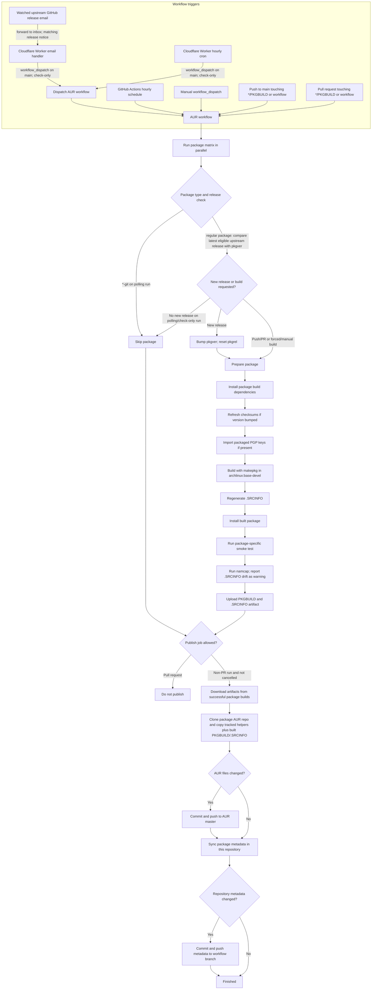

# Repository update and release flow

This diagram covers the release-trigger paths, package checks, isolated build/test stage, and publishing described in `.github/workflows/aur.yml` and `trigger/worker.js`.

Notes:
- The workflow's native schedule and the Worker cron both provide hourly checks; the Worker is a backstop because GitHub may delay or drop scheduled runs.
- The Worker forwards every notification email before checking whether it is a GitHub release notice. Matching notices dispatch a check-only run.
- Pull requests build and test but never publish. The publish job can publish packages that produced artifacts even if another matrix package failed.
- The AUR SSH key is only used in the publish job; that job downloads build artifacts and does not source or execute package `PKGBUILD` files.
- `*-git` packages follow their upstream branch and are skipped only for polling/check-only runs; they build on pushes, pull requests, and forced runs.
